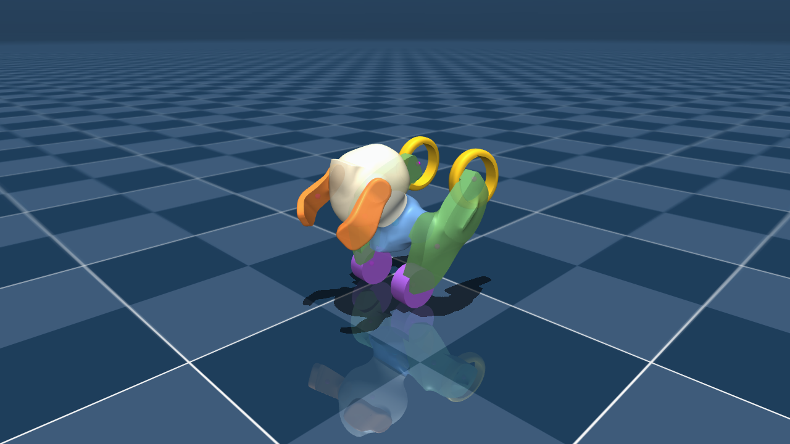

# PetBot upright：MuJoCo 策略体验

通过ONNX Runtime加载已训练策略，体验四轮行驶中起立、两轮遥控、前轮落地与普通控制交接。源模型从工作区 `robot_description/` 只读加载；本项目不包含训练代码。

当前默认为**新系列第20轮seed102的1000更新终局**，单Actor从随机初始化训练，不依赖旧父网络。旧C58包完整保留供切换比较。默认窗口两轮幅度0.15m/s、0.5rad/s，可用方向键调整；普通四轮保持完整源范围。

## 启动

在 PetBot 主仓库更新 `main`，然后物化这个独立项目：

```bash
repo sync rl_project/std_s2s_upright_project rl_project/std_train_upright_project
cd rl_project/std_s2s_upright_project
uv sync --locked --python 3.10
uv run --locked run.py --forward-speed 0.15 --turn-rate 0.5
```

需要桌面显示和 OpenGL。策略在 CPU 推理，不需要 Isaac Lab 或 CUDA；MuJoCo 渲染使用本地图形环境。没有显示的服务器使用下方 `--headless`。环境和运行产物不入库。单独检出本分支时可用 `--model-dir <robot_description目录>`，模型指纹必须与策略一致。

| 操作 | 效果 |
|---|---|
| 按住 W / S | 前进 / 后退；普通四轮默认请求 ±0.75 m/s，上述命令将策略期间限为 ±0.15 m/s |
| 按住 A / D | 左转 / 右转；普通四轮默认请求 ±15 rad/s，上述命令将策略期间限为 ±0.5 rad/s，可与 W/S 组合 |
| ↑ / ↓ | 两轮线速度上限增加 / 减少0.05 m/s；按住可连续调整，范围0至所选策略包上限 |
| → / ← | 两轮角速度上限增加 / 减少0.1 rad/s；按住可连续调整，范围0至所选策略包上限 |
| Shift + 方向键 | 精调：线速度每次0.01 m/s，角速度每次0.02 rad/s |
| 按住 Q / E | 普通四轮下抬头 / 低头，以0.5 rad/s调整两侧共同髋角，松键保持；策略调用期间禁用 |
| 释放 WASD | 请求零速度，控制器仍维持平衡；释放方向键保留当前上限 |
| Space | 四轮模式请求起立；起立中或两轮模式请求前轮落地；落地请求锁存到交接完成 |
| R | 显式恢复初始四轮状态 |
| 鼠标左键拖动 / 滚轮 | 旋转视角 / 缩放 |
| Esc | 退出 |

可以先按 W 行驶，再按 Space 请求起立；保持两轮后继续 WASD，最后按 Space 落地。头和耳的独立关节保持原位置目标；Q/E驱动的是左右车架/髋关节，改变头身整体俯仰。两轮时共同髋角由策略自主用于平衡。正常落地后回默认0rad，异常退出保持当时车架目标并交还普通控制，不等待回零、不复位实际姿态。

`--forward-speed`、`--turn-rate`设定窗口启动时的两轮上限，运行中可用方向键调整，无需重启。可在四轮时预设，或在两轮时边行驶边调；只改变策略期间的遥控限幅，普通四轮性能独立。上限松键后保持，按R复位机器人也保留，重启程序才恢复启动参数。W/S分别请求当前线速度幅度的正/负值，A/D同理；例如从0.15按一次↑后，W/S目标为±0.20 m/s，实际指令仍沿用原有平滑。上限为0时该轴请求零速；起立/落地沿用原速度继承和航向保持，不由新按键改写。组合指令仍受左右轮联合可达域限制。

`--frame 0.15`设置初始普通车架目标；所有策略包的普通车架范围均来自源模型[-1,1.2]rad。这个范围是控制器允许范围，不表示各角度均已通过起立验证。窗口显示原始操作者请求`Operator`、限幅/投影后目标`Target`、平滑及阶段处理后的实际策略指令`Command`、实测速度`Measured`和当前两轮上限。普通满幅请求可使Operator显示0.75，即使两轮Target只有0.15；判断响应应对照Command与Measured。

**新第20轮seed102仍未证明双向0.75m/s和宽髋角起立能力。** 起立沿用该轮训练的12秒时限、单网络连续控制，允许必要减速/调髋，没有强制停车或回零脚本。普通控制完整范围与策略分开。要用与此前体验一致的手动输入幅度，可显式设置普通与两轮参数，物理能力与策略范围不变：

```bash
uv run --locked run.py --forward-speed 0.15 --turn-rate 0.5 --ordinary-forward-speed 0.15 --ordinary-turn-rate 0.5
```

## 零输入落地后退修复（2026-11-02补充）

普通控制从确认四轮落地、进入HANDOFF时就响应当前WASD请求；零输入开始制动，持续按键继续行驶。保留首帧轮目标继承及原0.3秒平滑交接，髋关节归零和接地确认不再推迟操作者输入。异常退出同样响应当前请求，不自动重起。网络、源物理和落地策略未改。

上一版2d73de6只消除了永久速度锁存，仍在交接确认期间维持后退。本次三组42秒MuJoCo对照：首次四轮接触至停稳由1.11–1.17秒降至0.48–0.51秒，后退路程由29–37厘米降至12–14厘米；进入HANDOFF前800帧和首次普通轮目标保持一致。持续按键、交接中松键、异常退出及源码/接口回归通过，见[检验与残余问题](validation/20261102_prompt_handoff/review.json)。

**仍未达到零输入落地后原地不动。** 策略落地末段已有后退驱动，接管后还需要平滑制动；当前残余不能当作完整修复。两轮零指令约0.01m/s后漂也保留，需训练改善。首次[永久锁存修复记录](validation/20261102_idle_fix/review.json)仅说明最终停住，不证明及时停车。

## 新系列第20轮seed102预览（2026-11-02）

默认包`restart20_s102/update_001000`来自代码`40e926d`，训练独立run_id和检查点/网络SHA见[策略manifest](policies/restart20_s102/manifest.json)。只有一张`policy.onnx`，39维观测×5帧、3维动作；按原30ms策略周期、2ms物理步运行。旧C58的58×5观测和多网络控制不能用于这个新包，程序按manifest选择相应适配器。

Isaac独立默认起立32/32、静止循环32/32、低速60秒完整/基本32/32、高范围29/32；满速请求下前/后实测约0.487/0.535m/s，尚未达到双向0.75m/s。包上限是可请求范围，不是已通过的稳定能力。训练进度见主仓库当前交接，本包权重仍固定第20轮终局。

发布短测：MuJoCo3.16静止起立保持6秒后落地、0.15m/s与0.5rad/s混合遥控保持18秒后落地均完成；末端髋误差小于0.01rad。180组源码观测/目标逐项一致，27姿态轮间隙几何核对、普通双向全速、Q/E、Space历史重置、意外退出和4秒窗口加载通过。实测轮速峰值32.82rad/s仍有超调；这些是首次发布的有限检查。用户随后确认基本流程和运动能力改善、约0.6m/s体验较稳，但宽初态起立及零输入漂移仍有问题；不代表全范围sim2sim通过。见[检查记录](validation/20261102_restart20/review.json)。

保留旧C58，可用同样参数对照：

```bash
uv run --locked run.py --policy policies/cycle23_course_r58 --forward-speed 0.15 --turn-rate 0.5
```

新包普通控制使用与该轮训练相同的源范围控制。正常落地只增加默认髋位，保留实测速度继承；交接后新操作者指令重新取得速度控制权。起立中再次按Space会锁存落地请求，进入两轮后执行。意外退出继续普通控制，必须重新按Space才会再次起立。

## 历史第23批C58终局策略预览（2026-10-29）

历史默认`cycle23_course_r58/model_999`来自第23批课程组seed58的1000更新终局，原始检查点SHA以`bb3bbb53`开头。使用外层、完整父反馈和内部反馈三张ONNX图，保留60/20/2ms时序，并同步v25两轮轮速端点映射、连续准备与默认髋位落地。该历史选择见[selection_cycle23.json](policies/selection_cycle23.json)；模型包[manifest.json](policies/cycle23_course_r58/manifest.json)记录检查点与每张网络的SHA及导出校验。

同历史协议的Isaac低速180秒完整64/64、基本63/64；0.15m/s、0.5rad/s中速60秒完整62/64、基本48/64。高速、AW/DW高段差异、极端初态角仍有失败，不将包声明范围当作可靠能力范围。

发布前只做必要短测：MuJoCo混合0.15m/s、0.5rad/s保持18秒完成起落及基本遥控；+0.15rad静止起立保持12秒完成并回默认髋位。ONNX一致性、观测/反馈时序、Q/E、普通完整范围、意外倒下退出和窗口加载检查通过。用户随后在桌面体验后确认基本流程已跑通，后续重点提升不同抬头低头初态的起立和两轮运动能力；该认可不代表全范围性能已验证，详见[验证记录](validation/README.md#第23批c58预览2026-10-29)。

原第21批B保留，可在同样参数下切换比较：

```bash
uv run --locked run.py --policy policies/cycle21_parent_b_r42 --forward-speed 0.15 --turn-rate 0.5
```

## 历史第21批终局策略预览（2026-10-28）

此前默认`cycle21_parent_b_r42/model_299`来自完整循环第21批正式PPO终局，另有`cycle21_parent_a_r43`可选。它们不是`full_range21_gate_r42`工程8更新模型，也不包含第22/23批。**尚未通过完整范围或用户sim2sim验收**。历史来源、选择依据和Isaac结果见[selection_cycle21.json](policies/selection_cycle21.json)。

B在Isaac中速60秒原评估/新种子完整60/64、62/64，优于A的49/64、55/64；B全车架范围有退步，因此A也保留。两份终局包都包含完整父反馈网络，按原60/20/2ms控制时序执行，不能只替换旧外层网络。网络CUDA1024样本输出差0，35组观测与240子步目标对齐通过；这些工程检查不等于动作质量通过。

窗口中`--forward-speed`、`--turn-rate`仅设置策略调用期间的速度/转向限幅；普通控制的幅度由独立`--ordinary-forward-speed`、`--ordinary-turn-rate`设置，默认使用源模型完整上限±0.75m/s、±15rad/s，与所选策略及其限幅无关。普通驱动不使用策略的命令加速度或轮速变化率；实际加速度仍受源执行器力矩和接触动力学约束。新包省略策略参数时采用推荐0.15/0.5；旧包沿用对应声明范围，该范围不等于已验证的可靠能力。组合命令按左右后轮±25rad/s联合可达域投影，速度和转向不能同时取得各自单轴最大值。

无窗口脚本的`--forward-speed`、`--turn-rate`为场景请求幅度，默认0.04m/s、0.12rad/s；允许在源模型范围内设置，策略阶段再单独按包范围处理。`--ordinary-*`仅影响窗口按键幅度。日志分别保存原始操作者请求、有效命令和实测响应。

```bash
# 第21批A候选，同样的中速输入
uv run --locked run.py --policy policies/cycle21_parent_a_r43 --forward-speed 0.15 --turn-rate 0.5
# 显式选择历史第18批策略
uv run --locked run.py --policy policies/cycle18_long_r42
```

实际MuJoCo中，B完成低速180秒完整/基本遥控；中速60秒完成但停车漂移44.46mm，基本评分未通过。较高速度、全速、第二次起立与转弯接管仍失败。真实MuJoCo场景及保留的失败见[第21批验证](validation/README.md#第21批终局预览2026-10-28)。意外前轮回落/翻倒会结束本次调用并交还普通控制；再次起立须重新按Space，不自动重起。

## 历史第18批效果与限制

此前默认权重 `cycle18_long_r42/model_598` 来自第十八批完整状态续训，实际累计 600 次 PPO 更新。当时的选择依据与来源在 [selection_cycle18.json](policies/selection_cycle18.json)，网络/检查点 SHA、训练合同和 CUDA 导出校验在各策略 `manifest.json`。另保留 `cycle18_long_r43` 作同任务对照，可通过 `--policy policies/cycle18_long_r43` 选择。

默认车架下，已在 MuJoCo 完成一条 **180 秒两轮混合遥控→前轮落地→普通控制交接**：包含前后、左右、曲线及停车，基本遥控指标通过。该结果是固定场景诊断，不是随机初态成功率，也不是实机证明。

仍有明确失败：静止指令落地后可能卡在交接，+0.15 rad 初始车架出现落地超时，连续第二次起立出现超时。窗口会暂停并显示原因，按 R 复位；不会自动重置掩盖失败。重复起落、任意航向/车架/速度和任意时刻切换还未验证成熟。测试细节与失败见 [验证记录](validation/README.md)。



## 无窗口复现

```bash
uv run --locked run.py --headless --scenario mixed --output outputs/mixed_01
uv run --locked run.py --headless --scenario mixed --hold-seconds 180 --seconds 200 --output outputs/long_01
uv run --locked run.py --headless --scenario stationary --output outputs/stationary_01
uv run --locked run.py --headless --scenario mixed --cycles 2 --seconds 65 --output outputs/repeated_01
```

每次使用新的输出目录，保留 `summary.json` 和逐步 `trace.jsonl`。`--snapshot` 额外生成真实渲染帧，需要 EGL；可用速度参数或`--command-scale`在源模型范围内调整场景请求。退出 2 表示流程失败或未完成，并不等于程序崩溃。基本遥控未通过但完整动作结束时退出 0，必须同时阅读 `functional`、覆盖和失败字段。

## 代码与控制契约

- `run.py`：GUI / 固定诊断场景入口。
- `petbot_s2s/restart.py`与`restart_core/`：新系列单ONNX适配器及固定控制/观测源码，来源见`restart_provenance.json`；30ms/2ms时序，运行时不依赖训练checkout。
- `petbot_s2s/controller.py`：历史C58的58×5 观测、历史、外部模式请求与反复接管；`simulation.py`：MuJoCo 状态/接触力翻译与电机接口；`viewer.py`：按键按下/释放和显示。
- `petbot_s2s/core/`：固定训练源码的纯张量阶段/控制逻辑。`provenance.json`记录来源和部署扩展；普通控制在`ordinary.py`独立实现，`controller.py`负责输入所有权及默认落地目标。不依赖当前demo checkout随后如何修改。
- `policies/`：CPU ONNX网络及来源。运行时只加载manifest列出的`.onnx`，不回退到`.pt`；保留TorchScript文件仅供转换与审计。外层、内部反馈及其base输出、完整父网络均已转换。历史控制链为60ms策略、20ms冻结平衡反馈、2ms转向反馈；新系列只含单网络30ms控制；张量状态/控制计算仍用PyTorch，神经网络推理全部由ONNX Runtime执行。物理限位、力矩限幅和源模型不变。
- `checks/export_onnx.py`：用`uv run --locked --group export python checks/export_onnx.py`重建ONNX并逐输出检查。manifest保留源文件SHA、ONNX SHA及数值容差；图转换不等于闭环验收。
- `checks/operator_controls.py`：真实MuJoCo普通满幅、Q/E、输入所有权和禁止PT运行加载检查。
- `checks/validate_port.py`：开发时对照固定源码、观测、接触力、方向和按键。例：`uv run checks/validate_port.py --source ../../demo_project/upright_rl_demo --output outputs/port_check.json`。源码更新后需使用 provenance 指定的提交；不应为让检查通过而改来源 SHA。

物理引擎、接触求解和显式/隐式伺服仍存在差异。接口一致不等于物理轨迹一致；应依据闭环实测决定后续训练修改。正式训练项目仍为空，训练代码和历史检查点留在原位置。

## 过渡修正版体验（2026-10-27）

历史工程包仍可显式选择。体验此前已通过GPU短训/重载和MuJoCo180秒检查的工程候选：

```bash
uv run python run.py --policy policies/correction20_gate_r42
```

这份权重从原r42继承后更新8次，仍是0.05m/s、0.15rad/s的低速工程候选，**不是全模型能力范围正式训练结果**。新控制器让起立/落地保持切换方向，并继承实际前向速度；两轮段恢复WASD。落地使用body姿态和车架角的轮轴正解，前轮到位后交还普通控制。窗口按2ms物理步推进、在渲染帧间更新姿态，策略周期仍为60/20/2ms。

已实测静止/混合起落、180秒混合控制和连续2次起落；连续第3次起立超时、带转向速度接管后提前落地仍失败，不能宣称全范围通过。新旧控制器均通过35组观测对齐；拆分物理步后的395帧轨迹逐项相同。证据见[修正验证](validation/README.md#过渡修正版2026-10-27)。

`--transition-contract linear_heading`可把新控制逻辑显式用于旧网络，仅为开发干预。新候选包自身包含新契约，无需这个参数。`--takeover-yaw 0.12 --headless`可复现初始转动场景；不要隐去其失败。网络导出和工程检查均不能替代操作者验收。

### 全范围独立调用候选

策略清单的`task_profile=full_range`启用新版调用契约：起落保持切换航向，两轮阶段恢复遥控；意外前轮回落或翻倒结束本次调用，继续普通控制，下一次起立须重新按Space。中断与正常完成分别记录，真实翻倒不标为正常四轮姿态。每次调用清理策略历史/反馈缓存，同时保留实际物理状态和连续电机目标。

历史策略包保持其原合同。新版控制端已完成MuJoCo前轮回落/翻倒的状态故障注入与源码对齐检查，接口通过不等于学习策略已能在全范围稳定工作；训练候选和实际闭环证据见主仓库`docs/upright_cycle_v21.md`。

历史工程候选通过`--policy policies/full_range21_gate_r42`显式选择；当前默认已改为上方新系列第20轮seed102策略。无窗口诊断可用`--forward-speed`和`--turn-rate`设置幅度；取值须在该包声明范围内，控制器仍施加联合轮速限幅。`summary.json`分别记录正常完成与`interrupted_calls`，脚本不会在中断后把原定落地请求变成新起立。该候选全范围稳定性尚未通过。
